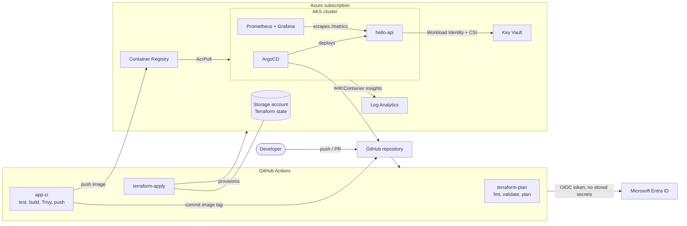

# Azure AKS GitOps Platform

A production-style Kubernetes platform on Azure, built entirely as code: **Terraform** provisions the infrastructure, **GitHub Actions** deploys it and builds the application using **passwordless OIDC**, and **ArgoCD** keeps the cluster in sync with Git.

> This is a personal lab project built to learn Azure by rebuilding a pattern I run on AWS (EKS, Terraform, GitHub Actions, ArgoCD). It is not presented as production work experience.

## What this demonstrates

- Infrastructure as code with reusable Terraform modules, remote state in Azure Storage, and separate `dev` and `prod` environments
- Passwordless CI/CD: GitHub Actions authenticates to Azure with OIDC federation, so no client secrets are stored anywhere
- Pull request workflow: `fmt`, `validate` and `plan` for both environments, with the plan posted as a PR comment
- Container pipeline: unit tests, image build, Trivy vulnerability gate, push to ACR
- GitOps delivery: ArgoCD (app-of-apps) deploys Helm charts; CI only commits the new image tag
- Secrets without credentials: Key Vault secrets mounted into pods through Entra Workload Identity and the Secrets Store CSI driver
- Observability: Azure Monitor Container Insights plus Prometheus and Grafana, with alerts at both layers
- Governance and cost control: Azure Policy, tags, ingestion caps, and a one-click destroy workflow

## Architecture



### Delivery flow

1. A pull request touching `terraform/**` runs `fmt`, `validate` and `plan` for dev and prod and comments the plan on the PR.
2. Merging to `main` applies dev automatically. Prod is applied manually and needs an approval on the `prod` GitHub Environment.
3. A change under `apps/**` runs tests, builds the image and scans it with Trivy. A fixable CRITICAL vulnerability fails the pipeline.
4. On `main`, the image is pushed to ACR and the pipeline commits the new tag to `helm/hello-api/values-dev.yaml`.
5. ArgoCD sees that commit and rolls the new version out to AKS. Manual drift in the cluster is reverted by self-heal.

## Tech stack

| Area | Tools |
|---|---|
| Cloud | Azure: AKS, ACR, Key Vault, Log Analytics, Azure Monitor, Azure Policy, Entra ID, Storage |
| IaC | Terraform (azurerm 4.x), remote state with Entra authentication and blob versioning |
| CI/CD | GitHub Actions, OIDC federation, Trivy |
| GitOps | ArgoCD (app-of-apps), Helm |
| Observability | Container Insights, kube-prometheus-stack (Prometheus, Grafana) |
| App | Python, FastAPI, Docker |

## Repository layout

```
bootstrap/        One-time setup: state storage, Entra app, OIDC trust, role assignments
terraform/
  modules/        network, aks, acr, keyvault, monitoring, alerts, platform (composition)
  envs/dev        Deployed environment
  envs/prod       Same modules, larger settings, plan-only in this lab
apps/hello-api/   FastAPI service, Dockerfile, unit tests
helm/hello-api/   Helm chart (deployment, CSI secret mount, ServiceMonitor, PrometheusRule)
gitops/           ArgoCD root app and child applications
scripts/          configure, bootstrap-argocd, smoke-test
.github/workflows terraform-plan, terraform-apply, terraform-destroy, app-ci
docs/             RUNBOOK.md (step by step), DECISIONS.md (design decisions)
```

## AWS to Azure mapping

| Concern | AWS | Azure (this project) |
|---|---|---|
| Managed Kubernetes | EKS | AKS |
| Container registry | ECR | ACR |
| Workload to cloud identity | IRSA | Entra Workload Identity |
| Secrets | Secrets Manager | Key Vault with Secrets Store CSI driver |
| CI to cloud auth | GitHub OIDC with IAM role | GitHub OIDC with Entra federated credential |
| Network | VPC and subnets | VNet, subnet and NSG |
| Logs and metrics | CloudWatch | Azure Monitor and Log Analytics |
| Guardrails | SCPs and Config rules | Azure Policy |
| Terraform state | S3 and DynamoDB lock | Blob Storage with native lease locking |

## Getting started

Full instructions are in [docs/RUNBOOK.md](docs/RUNBOOK.md). In short:

1. Create an empty GitHub repository and run `bootstrap/bootstrap.sh` once.
2. Push the infrastructure code. `terraform-apply` builds dev.
3. Run `scripts/configure.sh`, push the app and GitOps code. `app-ci` builds and pushes the first image.
4. Run `scripts/bootstrap-argocd.sh`. ArgoCD takes over.
5. Run `scripts/smoke-test.sh`.
6. Run the `terraform-destroy` workflow when you finish.

## Verification

| Test | What it proves | Expected result |
|---|---|---|
| PR touching Terraform | Plan automation | Plan comment for dev and prod |
| Change app message, merge | Full GitOps path | New version served by the API within minutes |
| Scale deployment to 0 manually | Self-heal | ArgoCD restores replicas |
| Set `replicaCount: 0` in Git | Prometheus alert | `HelloApiNoAvailableReplicas` fires after 1 minute |
| `/secret-check` | Workload Identity and Key Vault | `{"secret_mounted": true}` |
| Add a known vulnerable package | Security gate | `app-ci` fails at the Trivy step |
| Create a resource in another region | Azure Policy | Request denied by policy |

### Evidence

Add your own screenshots here after running the tests:

- `docs/img/argocd-synced.png`: ArgoCD showing `root`, `kube-prometheus-stack` and `hello-api` as Synced and Healthy
- `docs/img/pr-plan-comment.png`: Terraform plan posted on a pull request
- `docs/img/pipeline-run.png`: successful `app-ci` run including the Trivy step
- `docs/img/grafana.png`: Grafana dashboard for the cluster
- `docs/img/alert-firing.png`: Prometheus alert in the firing state

## Cost control

- AKS Free tier (no control plane fee), two small nodes, no public load balancer, no managed disks for monitoring
- Log Analytics daily ingestion capped at 0.5 GB
- ACR Basic
- `terraform-destroy` removes the environment after each session; state storage costs almost nothing and is kept

## Limitations and next steps

- Only `dev` is deployed. `prod` is planned in CI on every PR but not applied, to protect trial credit.
- Access to the cluster uses local Kubernetes accounts. Next step: Entra ID integration with Azure RBAC for Kubernetes.
- No ingress controller or TLS. Services are reached with `kubectl port-forward`. Next step: ingress-nginx, cert-manager and a DNS name.
- ACR has no private endpoint because that needs the Premium SKU.
- The pipeline identity has broad subscription-level roles for lab convenience. Scope them down in a real organisation.
- Prometheus data is not persisted and Alertmanager is disabled to fit a small cluster.

## What broke and how I fixed it

Fill this in from your real runs. It is the most credible part of the project.

| Problem | Cause | Fix |
|---|---|---|
| | | |

## Author

Your name, LinkedIn and GitHub links.
